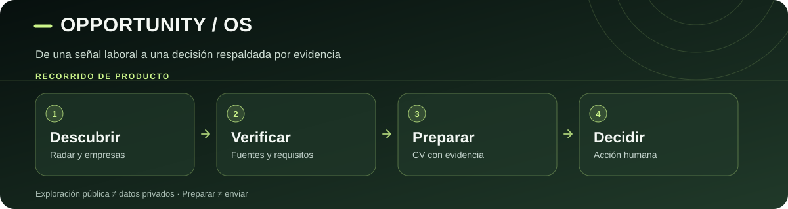

# Opportunity OS

**Encontrá oportunidades reales. Prepará mejores candidaturas. Conservá el contexto.**

Buscar trabajo no debería significar abrir veinte pestañas, repetir la misma información ni perder de vista a quién contactaste. **Opportunity OS** reúne ofertas laborales, empresas, evidencia y herramientas para preparar una búsqueda más ordenada.

No promete conseguir empleo ni enviar postulaciones sin tu decisión: **te ayuda a investigar, priorizar y actuar con información verificable**.

## Qué podés hacer

- **Explorar oportunidades:** consultar avisos capturados, empresas, sectores y alternativas freelance en la web pública.
- **Entender qué conviene priorizar:** filtrar ofertas y distinguir una vacante comprobada de una empresa que solo vale la pena investigar.
- **Preparar una candidatura:** generar CV de una página basado en experiencia y evidencias verificadas desde el flujo local.
- **No perder el hilo:** organizar contexto de contactos y procesos, revisar correos seleccionados y consultar métricas cuya cobertura esté clara.
- **Consultar el radar con Gemini:** hacer preguntas sobre datos públicos y contrastar capturas consecutivas cuando estén disponibles.

**Dos entornos, dos alcances:** la **web pública** permite explorar sin compartir tu historial personal. El **núcleo local** (Python/FastAPI y almacenamiento privado) prepara documentos y administra información sensible. La web no puede leer tu Gmail privado ni enviar postulaciones por sí sola.

## Cómo se usa

**[Explorar el código de la web](site/)** · **[Cómo funciona el radar y Gemini](docs/WEB_ORIENTACION_PUBLICA_RAG.md)**

> **Captura de pantalla:** pendiente de incorporar una imagen real de la versión publicada y su fecha. Preferimos no mostrar una interfaz inventada o desactualizada.

## Tecnologías principales

**Núcleo local:** Python, FastAPI, Pydantic, SQLite y RenderCV/Typst. **Web pública:** JavaScript, datos publicados por GitHub Actions, Leaflet y un endpoint de Gemini del lado del servidor. Cada integración tiene límites explícitos de privacidad, evidencia y autorización.

## Para profundizar

- **[Guía para ejecutar el flujo de CV](docs/OPPORTUNITY_OS_AGENT_RUNBOOK.md)** — instrucciones verificables para operadores y agentes.
- **[Roadmap](ROADMAP.md)** — capacidades del núcleo local y trabajo propuesto; no sustituye la revisión de PR recientes.
- **[Contratos de integraciones](docs/CROSS_REPO_HANDOFF_V01.md)** — qué información puede compartirse sin convertir hipótesis en vacantes.
- **[Referencia técnica anterior (conservada)](docs/README_TECHNICAL_REFERENCE_2026-11-06.md)** — detalles e historial preservados, **no** una garantía de actualidad.

**Para quien retome el proyecto:** contrastar `main`, PR mergeados, pruebas y despliegue activo antes de afirmar que una función está publicada. Un `PREPARED` no es un envío ni una postulación.

Licencia: MIT.
