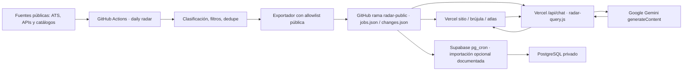
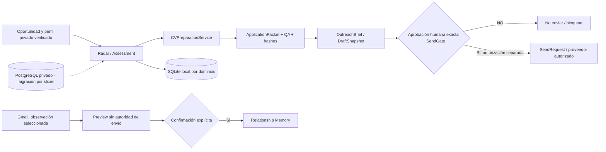
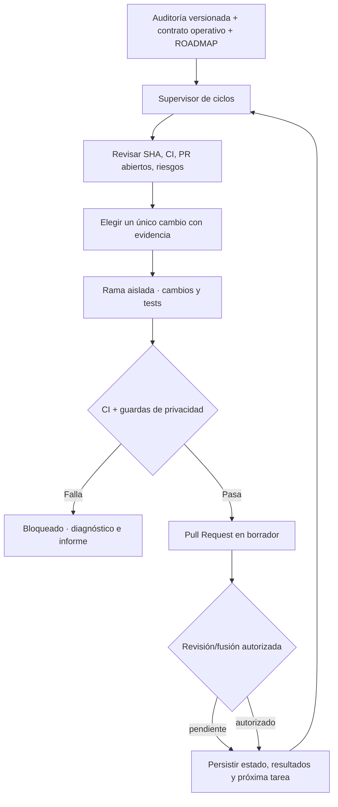

# Opportunity OS — Baseline de auditoría de arquitectura (2026-11-06)

**Estado:** auditoría documental del código; baseline versionada para el ciclo de agentes. **No es prueba dinámica de producción**.  
**Repositorio:** `juanmanueltorres-creator/opportunity-os`  
**SHA de evidencia:** `7b03b1256e9b52280652b5ecf79c9d22117da9da` (`main`, 2026-11-06).  
**Documento de origen:** informe de arquitectura HTML/PDF generado el 2026-11-06, “Opportunity OS — Arquitectura AS IS / TO BE”. Este Markdown preserva el diagnóstico, los diagramas conceptuales y el backlog ejecutable para futuras sesiones/agentes, sin depender de que la conversación original siga abierta.  
**Enmienda explícita:** la sección geográfica del informe original tomaba San Juan como caso regional relevante. **La prioridad corregida por el operador es: (1) remoto desde Argentina/Córdoba, (2) presencial/híbrido en Córdoba Capital, (3) relocalización a San Juan u otra provincia como alternativa secundaria**. La presente enmienda tiene prioridad sobre el orden territorial y la etapa P3 del informe histórico.

## 1. Dictamen ejecutivo

Opportunity OS ya implementa dos ámbitos de confianza distintos: `site/` ofrece exploración pública y Gemini fundamentado en evidencia pública; `app/` contiene radar, matching, CV, outreach controlado, memoria de relaciones y observaciones privadas. La base contiene guardas útiles: evidencia/procedencia, valores `UNKNOWN`, generación de CV con facts verificados, hashes de aprobación y separación entre preparación y envío.

**Brecha principal:** falta un supervisor duradero, con estado, presupuesto, parada segura y trazabilidad, que encadene las mejoras desde una auditoría sin reconstruir el contexto manualmente. La solución propuesta es un *control plane* de mantenimiento sobre el código existente, **no** un agente con permisos irrestrictos ni una plataforma nueva.

### Evidencia de arquitectura examinada

| Área | Estado observado en el SHA auditado | Rutas de evidencia |
| --- | --- | --- |
| Captura y ranking | Colectores, clasificación territorial, elegibilidad, matching, dedupe y diagnósticos | `app/radar/`, `app/connectors/`, `scripts/daily_job_radar.py` |
| Publicación pública | GitHub Actions diario → `radar-public/jobs.json` + `changes.json`; snapshots consecutivos | `.github/workflows/daily-opportunity-radar.yml`, `scripts/publish_public_snapshot.py`, `scripts/compare_public_snapshots.py` |
| Web/chat | JS estático, API serverless, consulta determinista de datos y Gemini solo con contexto público | `site/index.html`, `site/api/chat.js`, `site/api/radar-query.js`, `site/vercel.json` |
| Operación privada | FastAPI + repositorios SQLite locales y APIs privadas PostgreSQL diferenciadas | `app/main.py`, `app/postgres_read_api.py`, `app/postgres_workflow_api.py` |
| Persistencia | PostgreSQL/Supabase incremental, con `pg_cron` documentado; **no** migración completa de SQLite | `db/`, `docs/POSTGRES_SEARCH_RUNTIME.md`, `docs/POSTGRES_WORKFLOW_API.md` |
| CV/outreach | Pipeline de evidencia validada → CV una página → packet; autorización separada de envío | `app/cv/`, `app/outreach/`, `docs/OPPORTUNITY_OS_AGENT_RUNBOOK.md` |
| Tests/gobernanza | Workflows de pruebas, site smoke, runtime offline; `main` reportada sin branch protection en la auditoría | `.github/workflows/`, GitHub API/CI; revalidar en cada ejecución |

**Límite de la evidencia:** las pruebas de `main` observadas en la auditoría fueron exitosas, pero no demuestran configuración de Vercel, disponibilidad de Gemini, RLS activa, backups, eficacia de `pg_cron`, rendimiento bajo carga ni funcionamiento E2E de producción. **Volver a verificar condiciones cambiantes** antes de elevarlas a hechos.

## 2. Mapas de componentes (C4 simplificado)

### Vista AS IS — pública

### Vista AS IS — privada y frontera de autorización

### Vista TO BE — control plane de mejoras

Los mapas son conceptuales, no un inventario de procesos desplegados. El supervisor TO BE no se considera implementado por el hecho de existir esta documentación o una tarea programada.

## 3. Riesgos: backlog de auditoría con identificadores estables

Los niveles son severidades propuestas a partir de **inspección estática**, no vulnerabilidades demostradas por explotación.

| ID | Severidad inicial | Hallazgo auditado | Corrección verificable / aceptación |
| --- | --- | --- | --- |
| **R01** | Alta | `main` sin protección de rama (resultado GitHub API en auditoría) | Revalidar estado, habilitar reglas con autorización, impedir pushes directos, requerir checks y revisión, privilegiar permisos mínimos. |
| **R02** | Alta | Persistencia parcial en SQLite y PostgreSQL con dos superficies de lectura/escritura | Mapa de ownership, migración por dominio y reconciliación comprobada, rollback de cutover y sin double-write silencioso. Revisar PR #86–#88 antes de cambiar. |
| **R03** | Alta | Límite de chat con `Map` en memoria por instancia serverless | Medición de abuso/costo, rate limit distribuido, límites de cuota y caché/timeout sin fuga de datos privados. |
| **R04** | Alta | Falta de supervisor persistente del ciclo de mejoras | Ledger, estado, lease o exclusión de corridas, presupuestos, scope y máximo de un PR en progreso; parada segura y gates humanos. |
| **R05** | Media | CI no verifica por sí sola la API/chat y despliegues reales | Smoke de GET/POST con datos públicos y sin PII, validación de feed/delta, alarmas de disponibilidad, rollback documentado. |
| **R06** | Media | CSP contiene `unsafe-inline` y carga de CDNs externos | Revisión de scripts, retiro gradual de inline, SRI/autoalojado o hash/nonce, pruebas CSP antes de restringir. |
| **R07** | Media | Historial de cambios limitado a dos snapshots públicos consecutivos | Retención y métricas de cobertura; nunca inferir cierre real de una ausencia. |
| **R08** | Media | Clasificación territorial y de idioma con alcance limitado | Fixtures por modalidad, idioma laboral, elegibilidad y provincia; separar resultados investigables de accionables. **Prioridad territorial corregida**. |
| **R09** | A verificar | Backup, RPO/RTO, roles reales, `pg_cron`, costos y monitoreo no auditados | Inspección del entorno autorizado, pruebas de recuperación y evidencia de ejecución; sin afirmar estado productivo sin datos. |

**Riesgos cambiantes:** re-evaluar severidad, existencia y estado antes de trabajar; no “reparar” un problema ya resuelto.

## 4. Roadmap corregido (trazabilidad entre auditoría y mejoras)

| Etapa | Propósito y criterios de aceptación | Riesgos vinculados | Prioridad actual |
| --- | --- | --- | --- |
| **P0** | Gobernanza y baseline: protección de `main`, CI requerido, límites de autoridad y reporte por SHA. Configuración sensible por aprobación humana. | R01, R04 | Máxima |
| **P1** | Radar/Gemini observable: frescura y fuentes OK/ERROR/EMPTY, rate limit distribuido, pruebas sin PII, presupuesto de cuota. | R03, R05, R07 | Alta |
| **P2** | Persistencia privada: reconciliación SQLite/PostgreSQL por slices y cutover reversible, sin duplicaciones ni pérdida de historial. | R02, R09 | Alta, con cautela |
| **P3 — CORREGIDA** | **Orden territorial principal:** 1 remoto con contratación desde Argentina confirmada, 2 Córdoba Capital presencial/híbrido, 3 relocalización secundaria (San Juan u otras provincias). Fixtures para no inferir permiso remoto, idioma laboral o provincia por la sede de la empresa. | R08 | Alta para calidad del radar |
| **P4** | Supervisor de mantenimiento autónomo supervisado: un cambio por ciclo, CI, PR, documentación y memoria duradera. Demostrar 3 ciclos seguros antes de ampliar alcance. | R04, R01 | Incremental; ya existe automatización ChatGPT, no supervisor interno |
| **P5** | Escalabilidad guiada por mediciones: índices, caché, colas/workers y reducción de latencia/costos solo si un baseline prueba cuellos de botella. | R03, R05, R09 | Condicionada |

**No seguir rígidamente la numeración P0–P5:** primero atender regresiones verificadas, seguridad, utilidad laboral inmediata y PRs abiertos. Cada cambio debe citar como mínimo un `R##` y una `P#`, o explicar por qué se desvía del baseline.

## 5. Casos de uso críticos que deben sostener las pruebas

| ID | Caso | Condición de éxito |
| --- | --- | --- |
| UC01 | Descubrir vacantes diarias | Fuente y URL real; sin duplicación; `UNKNOWN` no se transforma en `YES`; frescura observable. |
| UC02 | Consultar mercado desde chat público | Conteos calculados por código sobre snapshot; enlaces a origen; no acceso a estado privado; límites explícitos. |
| UC03 | Preparar candidatura profesional | Usar flujo canónico, facts y evidencias verificados, PDF de una página y hashes; `PREPARED != APPROVE`. |
| UC04 | Contacto y seguimiento con permiso | Borrador + verificación + aprobación vinculada a contenido exacto; idempotencia y `SEND` separado. |
| UC05 | Movilidad interprovincial — secundaria | San Juan u otras provincias solo en `RELOCATION_REVIEW`; evaluar salario/costo de mudanza/modalidad/rotación y declarar desconocidos. |
| UC06 | Mantenimiento por agentes | Auditoría → branch → tests → PR → documentación → siguiente iteración; CI y gates humanos, sin push directo a `main`. |

## 6. Métricas objetivo propuestas — no afirmar resultados sin medir

- Frescura del radar: objetivo inicial `<=36 h`; alertar si se supera. Verificar `generated_at`.
- 100 % de fuentes intentadas devuelven diagnóstico `OK/ERROR/EMPTY` en cada corrida, incluso si fallan.
- 0 duplicaciones por clave canónica dentro del lote seleccionado, verificadas con fixtures.
- 100 % de los conteos laborales respondidos por Gemini provienen del cálculo determinista, no de aritmética imaginada por el modelo.
- 0 campos privados expuestos en el feed público o los artefactos del pipeline.
- 100 % de las modificaciones de código de agentes pasan por PR; 0 fusiones o despliegues automáticos no autorizados.
- P50/P95, errores y costo/consulta: establecer SLO únicamente tras medir 7–14 días; no inventar un baseline.

## 7. Cómo debe usarse esta auditoría

1. Leerla al comienzo de cada ejecución junto con `docs/OPPORTUNITY_OS_AUTONOMY_CONTRACT.md`, README y ROADMAP.
2. Comprobar por GitHub API el SHA, CI, ramas, PRs y situación de cada riesgo **antes** de aceptar el baseline como vigente.
3. Registrar en la descripción del PR: `Audit: R## / P# / UC##`, hipótesis, evidencia, test o métrica, efectos observados, rollback y estado.
4. Si una corrección modifica supuestos del baseline, actualizar esta página como **delta** con fecha y evidencia. No borrar hallazgos históricos ni alterar su procedencia retrospectivamente.
5. Priorizar resultados laborales: puestos remotos desde Argentina y Córdoba Capital. San Juan entra únicamente si la evaluación de relocalización es pertinente y opcional.
6. Respetar fronteras de seguridad: ningún agente puede interpretar un hallazgo de auditoría como autorización de desplegar, fusionar, enviar un CV, escribir correos, cambiar secretos o migrar datos reales.

## 8. Inventario fuente para la siguiente auditoría

- `README.md`, `ROADMAP.md`, `docs/OPPORTUNITY_OS_AGENT_RUNBOOK.md`
- `docs/WEB_ORIENTACION_PUBLICA_RAG.md`
- `docs/POSTGRES_SEARCH_RUNTIME.md`, `docs/POSTGRES_WORKFLOW_API.md`, `docs/SUPABASE_PUBLIC_RADAR_SYNC.md`
- `docs/LATAM_DISCOVERY_V1.md`, `docs/CORDOBA_REMOTE_SOURCE_LANES.md`
- `app/radar/daily_search.py`, `app/radar/territorial_discovery.py`, `app/radar/cordoba_filters.py`, `app/radar/eligibility.py`
- `site/api/chat.js`, `site/api/radar-query.js`, `site/vercel.json`
- `app/cv/service.py`, `app/outreach/send.py`, `app/main.py`, `app/postgres_read_api.py`
- `.github/workflows/tests.yml`, `.github/workflows/site-smoke.yml`, `.github/workflows/daily-opportunity-radar.yml`
- GitHub Actions `main` auditado: `42278115420`; confirmar siempre runs recientes y despliegues de forma independiente.

**Registro de decisiones:** esta baseline conserva los hallazgos del informe original pero sustituye su priorización de San Juan, expresamente corregida por el operador. Las futuras automatizaciones deben actualizar el estado de los riesgos con evidencia y no repetir auditorías desde cero.
